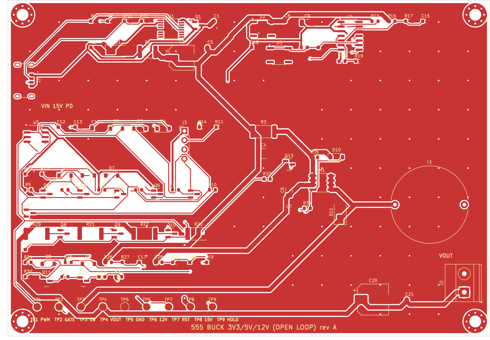
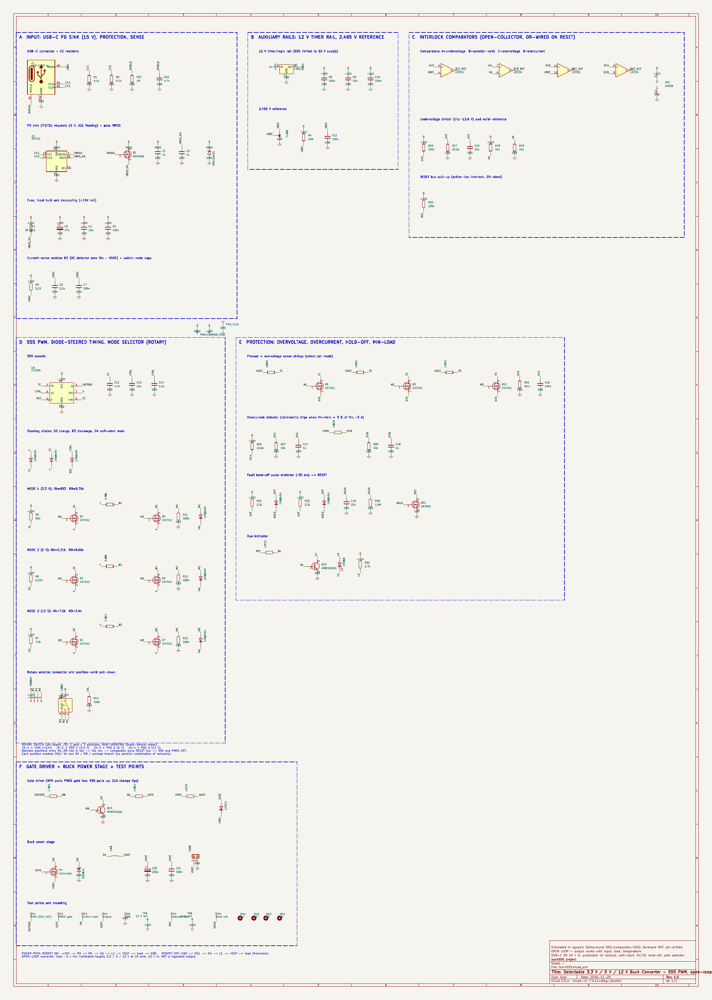
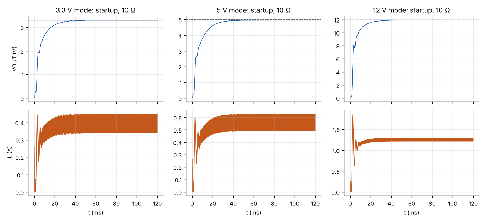
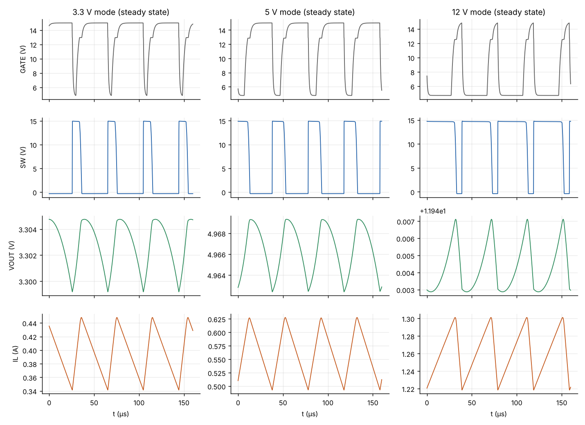

# INCEPT-3

### Selectable 3.3 V / 5 V / 12 V DC–DC Buck Converter

INCEPT-3 is a 15 V-input, three-mode buck-converter design built around a TLC555-based PWM controller and a discrete high-side P-channel MOSFET power stage. The project brings together analog control circuitry, USB-C Power Delivery input handling, power-stage design, protection logic, circuit simulation, schematic capture and two-layer PCB development.

I developed the circuit architecture and its supporting design assets from the ground up, using KiCad for the electrical schematic and PCB workflow, NI Multisim as part of the circuit-design/simulation workflow, and Python/SPICE tools for modelling, automated analysis and waveform visualisation.

---

## Project at a glance

| Parameter | Design |
|---|---|
| Project name | **INCEPT-3** |
| Converter topology | Asynchronous buck converter |
| Input | 15 V DC, USB-C PD source |
| Selectable outputs | 3.3 V / 5 V / 12 V |
| PWM controller | TLC555 CMOS timer |
| Switching frequency | Approximately 25 kHz |
| Power switch | FDS4435A P-channel MOSFET |
| Gate driver | MMBT2222A NPN transistor |
| Freewheel diode | SS34 Schottky diode |
| Output filter | 1 mH inductor, 220 µF capacitor, 100 nF bypass |
| Design approach | Open-loop, resistor-calibrated PWM selection |
| PCB | Two-layer KiCad design |

The three voltage settings are calibrated operating targets for a 15 V input and a 10 Ω load. The design uses selectable timing-resistor networks to set the PWM behaviour for each output mode.

## Design preview

**PCB layout**



**Electrical schematic**



**Startup response across the three output modes**



**Steady-state switching waveforms**



## Key features

- Three selectable output-voltage modes: 3.3 V, 5 V and 12 V.
- TLC555-based PWM generation with a diode-steered timing network.
- Three-position, non-shorting rotary selection with selector-valid interlocking.
- Discrete NPN gate drive for a P-channel high-side MOSFET.
- Asynchronous buck power stage with Schottky freewheeling path.
- USB-C PD input stage and auxiliary 12 V control rail.
- Soft-start, undervoltage lockout, output-overvoltage detection and overcurrent hiccup control.
- Python-based circuit-generation, calibration and waveform-analysis utilities.
- KiCad schematic, PCB, BOM, netlist, fabrication outputs and design documentation.

## System architecture

```text
USB-C PD 15 V INPUT
        │
        ▼
PD SINK + INPUT PROTECTION
        │
        ▼
15 V INPUT / CURRENT-SENSE NETWORK
        │
        ├──────────────► 12 V AUXILIARY RAIL
        │                         │
        │                         ▼
        │                 TLC555 + LM339 + TL431
        │                         │
        │                 SELECTABLE PWM CONTROL
        │                         │
        ▼                         ▼
P-CHANNEL MOSFET ◄──── NPN GATE DRIVER
        │
        ▼
SWITCHING NODE ──► INDUCTOR ──► OUTPUT FILTER ──► VOUT
        │                                      3.3 V / 5 V / 12 V
        ▼
SCHOTTKY FREEWHEEL DIODE
```

## Hardware design

The hardware is organised into functional blocks: USB-C PD input and protection, auxiliary supply and voltage reference, 555 PWM generation, rotary mode selection, comparator-based supervision, MOSFET gate driving and the buck-converter power stage.

The TLC555 operates from the 12 V auxiliary rail. Its 4.7 nF timing capacitor is charged and discharged through separate diode-steered paths. The selected RA/RB pair determines the timing characteristics for the requested output mode. The timer output drives an MMBT2222A transistor, which controls the gate of the FDS4435A P-channel MOSFET. An SS34 Schottky diode provides the inductor freewheeling path when the MOSFET is off.

The control and protection network includes an L78L12 auxiliary regulator, TL431 reference, LM339 comparator sections, selector-valid interlock, soft-start network, undervoltage detection, output-voltage monitoring and current-sense-based hiccup response.

## Selected component values

| Component | Value / part |
|---|---|
| Input voltage | 15 V DC |
| Timer | TLC555CDR |
| Timing capacitor | 4.7 nF C0G/NP0 |
| Inductor | 1 mH |
| Output capacitor | 220 µF, 25 V |
| Output bypass | 100 nF |
| Main MOSFET | FDS4435A |
| Gate driver | MMBT2222A |
| Freewheel diode | SS34 |
| Current-sense resistor | 0.15 Ω |
| Soft-start capacitor | 2.2 µF |

### Mode selection

| Mode | RA | RB | Target output |
|---|---:|---:|---:|
| 3.3 V | 953 Ω | 9.76 kΩ | 3.3 V |
| 5 V | 2.21 kΩ | 8.66 kΩ | 5 V |
| 12 V | 7.5 kΩ | 3.4 kΩ | 12 V |

## Simulation results

The supplied simulation result set includes startup response, steady-state switching waveforms, load sweeps, input-voltage sweeps, short-circuit response, output-energy injection, selector transitions and input-dropout behaviour.

The reported ngspice results at 15 V input and 10 Ω load are: 

| Metric | 3.3 V mode | 5 V mode | 12 V mode |
|---|---:|---:|---:|
| Average output voltage | 3.303 V | 4.966 V | 11.944 V |
| Output ripple (peak-to-peak) | 5.6 mV | 7.0 mV | 4.2 mV |
| Inductor current range | 0.341–0.448 A | 0.493–0.628 A | 1.218–1.301 A |
| Switching frequency | 25.3 kHz | 25.0 kHz | 25.1 kHz |
| Simulated efficiency | 62.5% | 72.9% | 86.8% |

All values in this table are simulation results from the supplied model and test conditions.

## PCB design

The KiCad PCB is a two-layer board with a 132 mm × 92 mm outline, ground copper pours, ground stitching vias, four M3 mounting holes and nine labelled test points. The layout places the USB-C input on the left and the output connector on the right, with dedicated areas for the control, protection and power-stage circuitry.

The project includes the editable KiCad schematic and PCB, project symbol and footprint libraries, BOM, netlist exports, PCB DRC report, schematic and PCB PDFs, Gerber layers, drill data and component-position output.

## Repository structure

```text
INCEPT-3/
├── README.md
├── docs/
│   ├── TECHNICAL_REPORT.md
│   └── design-history/
├── hardware/
│   └── kicad/
│       ├── buck555.kicad_pro
│       ├── buck555.kicad_sch
│       ├── buck555.kicad_pcb
│       ├── buck555_BOM.csv
│       ├── generators/
│       └── fab/
├── simulation/
│   ├── ngspice/
│   └── spice-reference/
└── results/
    └── plots/
```

## Tools and technologies

- **KiCad 7:** schematic capture, symbols, footprints, PCB layout and manufacturing exports.
- **NI Multisim:** circuit design and simulation workflow.
- **ngspice:** SPICE-based transient simulation and model execution for the included reproducible result set.
- **Python:** design automation, calibration utilities, simulation orchestration and waveform analysis.
- **NumPy / Matplotlib:** numerical processing and engineering plots.
- **Freerouting:** PCB autorouting workflow.

## Opening the design

1. Clone or download this repository.
2. Open `hardware/kicad/buck555.kicad_pro` in KiCad.
3. If prompted, confirm that the project-local `buck555` symbol and footprint libraries are available.
4. Open `buck555.kicad_sch` for the complete electrical schematic.
5. Open `buck555.kicad_pcb` to inspect the two-layer board.
6. Refer to `docs/TECHNICAL_REPORT.md` for the circuit architecture, pin connections, calculations and simulation results.

The project was authored with KiCad 7.0.11 file formats.

## Simulation assets

The `simulation/ngspice/` directory contains the netlist generator, device models, operating-mode suites, fault-analysis scripts and text result summaries. The `simulation/spice-reference/` directory contains the mode-specific SPICE references and component-to-node mapping used to reproduce the circuit in a SPICE-oriented simulator.

For the Python/ngspice workflow, install Python 3, NumPy and ngspice, then run the suite scripts from `simulation/ngspice/` so generated RAW and log files remain alongside the simulation sources. The plotting script in `results/plots/` reads those generated RAW files and writes the corresponding plots.

## Project focus

INCEPT-3 explores the integration of analog PWM control, discrete power switching, protection logic, circuit simulation and PCB design in a single selectable-output power-conversion system.
